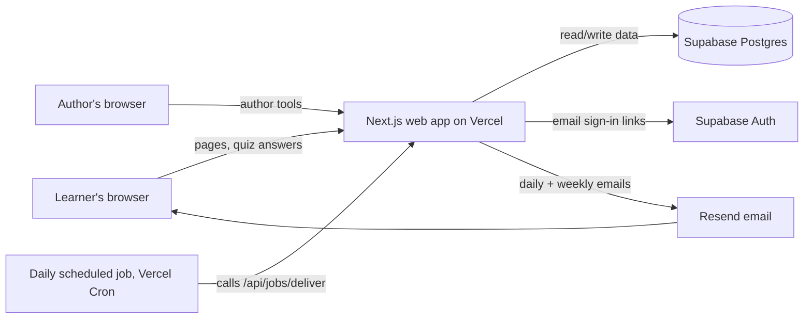
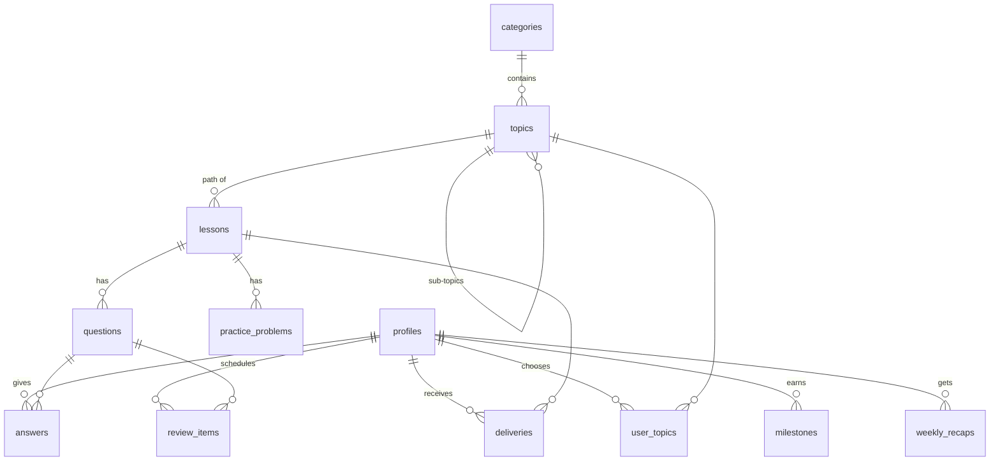

# Pisara: Design Doc

_Draft 2, November 3, 2026. Updated after the design review (see section 14). Builds on [user-stories-and-mvp.md](user-stories-and-mvp.md); story IDs like B1 refer to that document._

## 1. Overview

Pisara is a web app that delivers one short lesson a day, picked at random from the learner's chosen topics and weighted by interest. Lessons arrive in an inbox and by email. Each lesson ends with a short multiple-choice quiz and one spaced review question. Authors add categories, topics, and lessons through built-in author tools.

### Goals for the MVP
- One person can build, run, and pay for it (ideally on free tiers).
- Every learner gets exactly one lesson a day, from a single daily run.
- The picking, review, and milestone rules are simple, tested functions, easy to tune later.
- Data needed to measure the success targets (week-3 retention, quiz accuracy) is recorded from day one.

### Non-goals for the MVP
- Native mobile apps, push notifications
- AI-generated lessons
- Sign-in other than email links
- Contributors, payments, social features
- Scaling past a few thousand learners

## 2. Architecture



One web app does everything: pages for learners, pages for authors, and a few API routes. Once a day, a scheduled job calls one of those routes to deliver that day's lesson to every learner.

## 3. Tech stack

| Part | Choice | Why | Alternatives |
|---|---|---|---|
| Language | **TypeScript** | One language for pages, server code, and emails. Catches mistakes early. | — |
| Web framework | **Next.js** (App Router) | Pages and API routes in one project; huge community; first-class hosting on Vercel. | Remix, SvelteKit |
| Database | **Supabase Postgres** | Real relational database with a free tier and a web dashboard for looking at data. | Neon, PlanetScale |
| Sign-in | **Supabase Auth** (email sign-in links) | Email sign-in links built in (A1). Google/Apple can be switched on later (A7) without changing accounts. | Auth.js, Clerk |
| Email | **Resend** + React Email | Simple API, emails written as components, supports the one-click unsubscribe header. | Postmark, Amazon SES |
| Hosting | **Vercel** | Deploys automatically from GitHub. | Netlify, Render |
| Scheduled jobs | **Vercel Cron** calling an API route once a day (8am Eastern) | Delivery runs once a day for everyone, which Vercel's free plan supports. If learners can choose their own time later (A8), this moves to an hourly job, for example Supabase Cron. | Supabase Cron, GitHub Actions schedule |
| Styling | **Tailwind CSS** | Fast to build a clean, mobile-friendly UI. | Plain CSS modules |
| Lesson text | **Markdown** | Easy to write; supports headings, lists, bold, examples. | Rich-text editor (later) |
| Tests | **Vitest** | Fast unit tests for the picking and review rules. | Jest |

_Free-tier limits change. Check each service's current limits before launch. At the MVP's size (tens of learners) all of these should be free or close to it._

## 4. Data model



### Content (written by authors)

**categories**
| Column | Type | Notes |
|---|---|---|
| id | uuid | |
| name | text | e.g. "Science" |
| position | int | Display order |

**topics**
| Column | Type | Notes |
|---|---|---|
| id | uuid | |
| category_id | uuid | Set on top-level topics. Sub-topics belong to their parent's category. |
| parent_id | uuid | Null for a top-level topic. Otherwise the parent topic, which is also its prerequisite (A3a). Any depth. |
| position | int | Display order among siblings |
| name | text | e.g. "Astronomy", or "Black holes" under "Stars" |
| goal | text | e.g. "Understand the life cycle of a star" (A3) |
| description | text | Short blurb for the topic picker |
| outline | text | Author's path outline, Markdown (E2) |

A topic is shown to learners when it has at least 3 published lessons (E4). A parent with too few lessons is still shown as a heading if any of its sub-topics are shown. Every topic in the tree can be picked, not just the deepest ones.

**lessons**
| Column | Type | Notes |
|---|---|---|
| id | uuid | |
| topic_id | uuid | |
| position | int | Order in the path. Gaps allowed so lessons can be inserted. |
| level | int | 1 Beginner, 2 Intermediate, 3 Advanced (E6). Pages always show the word. |
| title | text | |
| body | text | Markdown, any length |
| reading_minutes | int | Auto-estimated at 200 words/min, editable (E6) |
| status | enum | `draft`, `published`, `unpublished`. Unpublished lessons stay in existing inboxes and history but are never picked again, and their questions are left out of review (E7). |
| published_at | timestamptz | |

**questions**
| Column | Type | Notes |
|---|---|---|
| id | uuid | |
| lesson_id | uuid | |
| position | int | |
| prompt | text | |
| options | text[] | 2–4 choices |
| correct_index | int | |
| explanation | text | One line, shown after answering (C2) |

A lesson can have no questions: the quiz is optional, and authors can publish a lesson without one.

**practice_problems** (optional, any number per lesson)
| Column | Type | Notes |
|---|---|---|
| id | uuid | |
| lesson_id | uuid | |
| position | int | |
| prompt | text | Markdown |
| solution | text | Markdown worked solution, hidden until the learner taps "Show solution" |

Practice problems aren't graded or recorded and never enter review. Readable by anyone who can read the lesson, like its questions.

### Learner data

**profiles** (one per account; linked to Supabase Auth by user id)
| Column | Type | Notes |
|---|---|---|
| id | uuid | Same as the auth user id |
| email | text | Unique. Accounts are keyed by email (A7). |
| display_name | text | Optional, up to 50 characters. Used in greetings; never shown to other learners. |
| time_zone | text | IANA name, e.g. "America/Chicago". Decides the learner's local date and recap day (A5). |
| weekly_recap_day | int | 0–6, default Sunday (C7) |
| emails_enabled | bool | One-click pause/unsubscribe (B3) |
| paused_until | date | Vacation pause (D6) |
| waiting_reminders_sent | int | 0, 1 or 2. How many "lessons waiting" emails went out since the inbox filled (B6). Reset to 0 when a lesson is read. |
| waiting_reminder_sent_on | date | Local date of the last "lessons waiting" email |
| role | enum | `learner` or `author` |
| created_at | timestamptz | |

**user_topics**
| Column | Type | Notes |
|---|---|---|
| user_id, topic_id | uuid | Primary key together |
| interest | int | 0 = Off, otherwise 1–5. The level is also the weight (A4). |
| last_delivered_at | timestamptz | Used for the freshness boost (B2) |

**deliveries** (the inbox)
| Column | Type | Notes |
|---|---|---|
| id | uuid | |
| user_id | uuid | |
| lesson_id | uuid | |
| kind | enum | `daily` or `extra` (B7) |
| local_date | date | The learner's local date it was delivered for |
| delivered_at | timestamptz | |
| read_at | timestamptz | Null = unread, so it's in the inbox (B6) |
| quiz_completed_at | timestamptz | Null if quiz skipped |

Unique on (user_id, local_date) where kind = `daily`, so a learner can never get two daily lessons on one day, even if the job runs twice.

Progress in a topic = the lessons in it the learner has **read** (`read_at` is set). Their level in a topic = the highest level among those lessons, shown as Beginner, Intermediate or Advanced. The next lesson = the lowest-position published lesson in that topic not yet delivered to them.

**answers**
| Column | Type | Notes |
|---|---|---|
| id | uuid | |
| user_id | uuid | |
| question_id | uuid | |
| context | enum | `lesson`, `review`, `weekly` |
| chosen_index | int | |
| correct | bool | |
| answered_at | timestamptz | |

**review_items** (C5, C6). Created only when a learner misses a question.
| Column | Type | Notes |
|---|---|---|
| user_id, question_id | uuid | Primary key together |
| step | int | 0–4, index into the review intervals |
| due_on | date | Learner's local date |
| last_correct | bool | |

**weekly_recaps** (C7)
| Column | Type | Notes |
|---|---|---|
| id | uuid | |
| user_id | uuid | |
| week_start | date | |
| question_ids | uuid[] | 5 questions |
| completed_at | timestamptz | |

**milestones** (D3)
| Column | Type | Notes |
|---|---|---|
| user_id | uuid | |
| kind | text | e.g. `lessons_10`, `level_up:astronomy:2` (2 = Intermediate), `topic_goal:astronomy` |
| achieved_at | timestamptz | |
| shown_at | timestamptz | Null until shown |

Unique on (user_id, kind), so each milestone is earned once.

## 5. Core rules

These live in one folder (`lib/rules/`) as plain functions with no database access, so they can be unit tested directly.

### 5.1 Picking the daily topic (B1, B2)

```text
eligible topics = topics where
    interest > 0
    and the topic has a published lesson not yet delivered to this learner
    and NOT (this topic was picked on each of the last 2 days
             and some other topic is eligible)

for each eligible topic:
    weight    = interest                            // 1–5; Off topics aren't eligible
    days      = days since last_delivered_at (never = 10)
    freshness = 1 + min(days, 10) * 0.10            // up to 2×
    score     = weight * freshness

pick one topic at random, with probability score / sum(scores)
```

The random function is passed in so tests can control it.

### 5.2 The inbox (B6)
- Before picking, count the learner's unread deliveries. If there are 3, skip the pick and the daily email for today.
- "You have 3 lessons waiting" goes out on the first day the inbox is full and once more 7 days later, then never again while it stays full. `waiting_reminders_sent` tracks this.
- Reading a lesson sets `read_at` and resets `waiting_reminders_sent` to 0. Finishing or skipping the quiz doesn't change inbox status.

### 5.2a Extra and first lessons (B7, A6)
- **Extra lesson:** from Home or a topic page. From a topic page, it's the next lesson in that topic's path, whether or not the topic is turned on. "Surprise me" uses the daily pick (5.1), without the "not 3 days in a row" rule. It counts toward the 3-lesson inbox, so it isn't offered while 3 lessons are waiting. No email is sent.
- **First lesson:** right after onboarding, one lesson is picked as today's daily lesson, so the daily run skips the learner until tomorrow.

### 5.3 Review scheduling (C5, C6)

```text
INTERVALS = [1, 3, 7, 21, 60]   // days

after an answer to a lesson quiz question:
    if wrong and no review item exists: create one at step 0, due tomorrow
    if right: nothing (questions answered right the first time never enter review)

after an answer to a review or weekly recap question:
    if correct: step = min(step + 1, 4)
    else:       step = 0
    due_on = today + INTERVALS[step]
```

A wrong answer is due tomorrow. A right one comes back in 3, then 7, 21, and 60 days.

**Choosing review questions after a lesson quiz:** up to 2 due items, earliest `due_on` first, preferring topics different from today's lesson. Items whose lesson is unpublished are skipped. If nothing is due, no review questions. Items not shown stay due and come up on later days, oldest first.

_Why only missed questions:_ if every question entered review, a learner would add 2–3 items a day, each needing about 5 more answers, or roughly 12 review answers a day. With only missed questions (15–40% at the target accuracy), up to 2 a day plus the 5-question weekly recap roughly keeps up.

### 5.4 Weekly recap (C7)
On the learner's recap day, if they read 2 or more lessons in the past 7 days, build a recap of 5 questions: due review items first, then questions from this week's lessons they got wrong, then any from this week's lessons. It appears on Home below the waiting lessons, and that day's email mentions it.

### 5.5 Milestones (D3)
Checked after each quiz is submitted:
- Lessons read: 1, 10, 25, 50, 100, then every 100
- Intermediate or Advanced reached in a topic (the highest level of lesson read in it goes up), so at most twice per topic
- All published lessons in a topic's path read (topic goal reached)
- A review question answered correctly at step 3 or higher (remembered after 21+ days)

At most one milestone is shown per day. If several are earned, the biggest is shown and the rest are recorded without being shown. Wording never mentions days in a row or missed days.

### 5.6 Sub-topics and prerequisites (A3a, D8)
- **Prerequisite note:** when a learner turns on a sub-topic and hasn't read every published lesson in its parent, show "This builds on {parent}, which you haven't finished." Never block. Only the direct parent is checked.
- **Go deeper:** when a learner reads the last published lesson in a topic that has visible sub-topics, offer those sub-topics on the screen after the quiz and on the progress page.
- Picking (5.1) treats every turned-on topic the same, whatever its depth.

## 6. Scheduled jobs

### Daily delivery job
The daily run is at 8am Eastern (America/New_York), all year. Vercel Cron only uses UTC, so it calls `GET /api/jobs/deliver` with a secret key at both 12:00 and 13:00 UTC, and only the call that lands in the 8am hour in New York runs (12:00 UTC in summer, 13:00 UTC in winter). 8am Eastern is 5am in California and 3pm in Finland.

```text
for each learner where
    emails are enabled or they have used the site in the last 14 days,
    and paused_until is empty or in the past:

    local date = today in their time zone
    if a daily delivery already exists for that local date: skip
    if inbox has 3 unread: send "lessons waiting" email if due (5.2); skip
    pick topic (5.1); find next lesson; insert delivery
    if it's their weekly recap day: build recap (5.4)
    send daily email
```

- Each learner is handled separately, so one failure doesn't stop the rest. Failures are logged.
- The unique (user_id, local_date) rule makes the job safe to run twice.
- Everyone gets the email at the same moment, so for some learners it arrives at night. That's the trade-off for one simple run; choosing a time (A8) can come later.

### Welcome lesson (A6)
When a learner finishes onboarding, the same delivery logic runs once immediately, so they don't wait until tomorrow.

## 7. Pages

21 pages for the MVP. Paths are suggestions. States of a page (such as "check your email" after requesting a sign-in link) are listed with the page, not as pages of their own.

### Signed-out visitors
Explore and the topic page are shared with signed-in learners, who see their own controls on them.

| Path | Page | What it shows | Stories |
|---|---|---|---|
| `/` | Landing | What Pisara is and how it works, email sign-up, "Browse topics". Signed-in learners go to Home. | A1, A9 |
| `/explore` | Explore topics | Categories and the topic tree; each topic's description, goal and lesson count. Only topics with 3+ published lessons. | A2, A3, A3a, A9 |
| `/explore/[topic]` | Topic page | Goal, description, lesson count, parent (with prerequisite note), sub-topics. Signed out: "Read the first lesson free" and sign-up. Signed in: interest control, level, lessons read, Start (an extra lesson in this topic), "New lessons coming soon". No lesson list, so there's no reading ahead. | A3, A3a, A4, A9, D1, D2, E5 |
| `/explore/[topic]/preview` | Lesson preview | The topic's first published lesson with its practice problems and quiz. Nothing saved. Ends with sign-up. | A9 |

### Sign-in and email links
| Path | Page | What it shows | Stories |
|---|---|---|---|
| `/sign-in` | Sign in | Email field, "Send me a link"; then "Check your email" with "Send again". Also creates new accounts. | A1 |
| `/sign-in/expired` | Sign-in link problem | For links already used or past 15 minutes; send a new one. `/auth/callback` has no screen and routes to onboarding or Home. | A1 |
| `/email/[token]` | Email preferences | Opened from any email without signing in: emails paused right away, with Undo; pause until a date; stop all emails. | B3, D6 |

### Learner
| Path | Page | What it shows | Stories |
|---|---|---|---|
| `/onboarding` | Onboarding | Optional display name, detected time zone; topic tree with interest (one tap = level 3), prerequisite notes, note above 8 topics; at least one topic required; first lesson delivered on finish. | A2–A6, A3a, A10, D4 |
| `/home` | Home | The main page after sign-in, on phone and desktop. Current lesson on top, other unread lessons below, then the weekly recap card on recap day; "Surprise me" for an extra lesson. Never mentions the 3-lesson limit. States: caught up, paused, all topics finished. | B5, B6, B7, C7, D6, E5 |
| `/lessons/[id]` | Lesson | Reading time and body; opening marks it read. Then practice problems with "Show solution", if any. Then the quiz, if any, plus up to 2 due review questions, with "Skip quiz". Results appear on the same page: explanations, re-read link, milestone, "Go deeper", next lesson. Only delivered lessons open. | B4, B5, C1–C6, C10, D3, D8 |
| `/recap/[id]` | Weekly recap | Five questions one at a time, then results and any milestone. | C7, C6, D3 |
| `/progress` | Progress | Topic tree with level and lessons read toward each goal, "Go deeper", review accuracy, total lessons read. | D1, D8, C9 |
| `/history` | Lesson history | Read lessons newest first, filter by topic, re-read. | D5, C4, E7 |
| `/topics` | My topics | Topic tree with interest controls and a Start button on each turned-on topic for an extra lesson in it; prerequisite notes, note above 8 topics. | B7, D2, D4, A3a, A4, E5 |
| `/settings` | Settings | Display name, email, time zone, recap day, emails on/off, pause, sign out, delete account (with confirmation). | A5, A10, B3, D6, D9 |

### Author (role = author only)
Anyone else gets the not-found page. Categories are edited inline on `/author`.

| Path | Page | What it shows | Stories |
|---|---|---|---|
| `/author` | Author home | Categories (add, rename, reorder) and topic trees with lesson counts by status and whether learners can see each topic yet. | E1, E4, E5 |
| `/author/topics/[id]` | Topic editor | Name, category or parent, description, goal, outline, sub-topics, ordered lesson list (drag to reorder). | E1, E2, E5, E6 |
| `/author/lessons/[id]` | Lesson editor | Title, level, Markdown body with live preview, reading time; optional practice problems (prompt and worked solution); optional quiz of up to 3 questions; publish and unpublish; "Preview as learner". | E4–E7 |

### System
| Path | Page | What it shows |
|---|---|---|
| any unknown path | Not found | Message and a link home. |
| on failure | Error | Message, "Try again", link home. |
| `/privacy`, `/terms` | Privacy and terms | What's collected and how to delete it (section 9). Linked from the landing page, sign-in and every email. |

## 8. Emails

| Email | When | Contents |
|---|---|---|
| Sign-in link | On request | Link valid 15 minutes, single use |
| Daily lesson | Daily run | Topic, title, reading time, "Read lesson" button. Mentions the weekly recap on recap day. |
| Lessons waiting | Daily run, inbox full: first day, then 7 days later, then never again | "You have 3 lessons waiting," button to inbox |

Every learner email includes a one-click pause/unsubscribe link and the standard `List-Unsubscribe` header, so email apps show their own unsubscribe button.

Emails link to the lesson page; lessons aren't included in full in the email, so reading and quizzes always happen on the site, where they're recorded.

## 9. Security and privacy

- **Database access rules (Supabase row-level security):** signed-out visitors can browse categories and topics and read each topic's first published lesson as a free preview, so they can try Pisara before signing up. Learners can open only lessons delivered to them (no reading ahead in a path) plus the free previews, and only their own learner data. Only authors can write content.
- **Author role** is set by hand in the database for the MVP.
- **Job endpoint** requires a secret key stored in environment variables.
- **Lesson Markdown is sanitized** when rendered, so no scripts can run.
- **Data collected:** email, an optional display name, time zone, settings, and learning activity. No tracking pixels, no third-party analytics in the MVP.
- **Delete account** removes the profile and all learner data (D9).

## 10. Accessibility

Pisara must meet **WCAG 2.2 level AA** on every page and email, for learners and authors alike. This is the standard US courts and the DOJ use for the ADA, and the same level the EU's accessibility rules require. It's a release requirement, not a polish step: a page that fails it isn't done.

### Rules for every page
- **Keyboard:** everything works with the keyboard alone, in a sensible order, with no traps. Quiz answers can be picked with arrow keys and Enter. Drag to reorder in the author tools also has Move up / Move down buttons (2.5.7).
- **Visible focus:** a clear focus ring on every focusable element, at least 3:1 against what's around it, never hidden by sticky headers (2.4.7, 2.4.11).
- **Color contrast:** 4.5:1 for normal text, 3:1 for large text, borders, icons and focus rings. Checked automatically from the color tokens (see section 12).
- **Color is never the only signal:** right and wrong answers also show an icon and the words "Correct" or "Not quite".
- **Tap targets:** at least 24 by 24 px (2.5.8); aim for 44 px on quiz answers and main buttons.
- **Structure:** one `h1` per page, headings in order, landmarks (`header`, `nav`, `main`), and a "Skip to content" link. Every page has a unique `<title>`. `lang="en"` on the page.
- **Forms:** every input has a visible label. Errors say what's wrong and how to fix it, are linked to the field, and are announced. The sign-in form allows pasting and password managers (3.3.8).
- **Announcements:** quiz results, "check your inbox", and saved settings are announced to screen readers through a live region. Moving between pages moves focus to the new page's heading.
- **Zoom and small screens:** works at 200% zoom and 320 px wide with no sideways scrolling (1.4.10). Text sizes in `rem`, so the reader's font size setting applies.
- **Motion:** milestone celebrations and other animation respect `prefers-reduced-motion`. Nothing flashes.
- **Time limits:** none on lessons or quizzes. The 15-minute sign-in link is the only one, and requesting a new one is easy.
- **Lesson content:** authors must give images alt text (the editor asks for it), use real headings in Markdown, and write link text that makes sense alone. Code blocks scroll on their own instead of the page.
- **Help is consistent:** the help or contact link sits in the same place on every page (3.2.6).

### Emails
Real text (not images of text), a heading, readable link text instead of "click here", `lang` set, the same contrast rules as the site, and a plain-text version.

### How it's checked
| Check | Catches | Runs |
|---|---|---|
| Color contrast test (`lib/a11y/`) | Any token pair below AA | Every PR (Vitest) |
| `eslint-plugin-jsx-a11y` (strict), `npm run lint` | Missing alt text, unlabeled controls, bad ARIA | Every PR and in the editor |
| axe in component tests (`vitest-axe`) | Problems in each component and its states | Not set up yet. The page tests cover each page's main state |
| Playwright + axe on every page, signed out, as a learner and as an author, light on desktop and dark on a phone (`npm run test:pages`, in `e2e/`) | WCAG 2.2 AA failures on real pages, sideways scrolling, plus keyboard-only runs of sign-in, onboarding and a quiz | Every PR |
| Lighthouse CI | Accessibility score must be 100 | Not set up yet |
| Manual checklist ([accessibility-checklist.md](accessibility-checklist.md)) | What tools can't judge: focus order, screen reader experience, clear wording | Every PR that changes UI, and in full before each release |

Automated tools find only a third to a half of real problems, so the manual checklist isn't optional.

## 11. Measuring success

The success targets in the MVP doc come straight from the database, with no analytics service needed:

| Measure | Source |
|---|---|
| Lessons opened per week | `deliveries.read_at` |
| Learners active 3+ days a week | Distinct `local_date` of reads per learner per week |
| Quiz accuracy | `answers.correct` where context = `lesson` |
| Review accuracy over time | `answers.correct` where context = `review`, by week |

A simple author-only `/author/stats` page can show these later. For the MVP, saved SQL queries in the Supabase dashboard are enough.

## 12. Testing

- **Unit tests** for everything in `lib/rules/`: topic picking (including the "not 3 days in a row" rule and odds over many runs), review steps (missed questions only, up to 2 a day), recap building, milestones, inbox limit and "lessons waiting" reminders, prerequisite notes and "Go deeper".
- **Time zone tests** for the delivery job: local dates across several zones (including ones where the run is already tomorrow), daylight saving changes, and the job running twice.
- **Accessibility checks** on every PR: contrast, lint, axe in component and page tests, Lighthouse. See section 10.
- **Manual checklist** before each release: sign up, onboard, read, quiz, get emails, author publishes a lesson. Includes the [accessibility checklist](accessibility-checklist.md).

## 13. Build plan

| Phase | What gets built | Ends with |
|---|---|---|
| 1. Setup | Next.js project, Supabase project, database tables, deploy to Vercel, accessibility checks (lint, axe, Playwright, Lighthouse CI) in the PR check | Empty app live at a URL |
| 2. Author tools | Categories, topic tree, lesson editor, publish | Author can add real lessons |
| 3. Content | Write 3+ lessons for each of a few topics | Enough content to test with |
| 4. Learner flow | Sign-in, onboarding, inbox, lesson page, quiz, progress | Founder can use it by hand |
| 5. Delivery | Picking rules, daily job, daily and "lessons waiting" emails | Lessons arrive on their own |
| 6. Review & celebrations | Review questions, weekly recap, milestones | Full MVP |
| 7. Founder test | Use it daily for 2 weeks, fix what's annoying | Ready to open sign-up |

## 14. Decisions in this doc

- **Accessibility:** WCAG 2.2 AA is a release requirement, checked automatically on every PR and by hand before release (section 10).
- **Email provider:** Resend.
- **Tech stack:** Next.js (React) + TypeScript, Supabase (database, sign-in), Vercel (hosting, daily scheduled job).
- **Weekly recap delivery:** in the inbox, with a mention in that day's lesson email. No separate email.
- **Lesson levels:** Beginner, Intermediate and Advanced, stored as 1–3 (decided Nov 5, 2026). The same words show a learner's standing in a topic. _Draft 2 had open-ended numbered levels._
- **Delivery time:** one run a day for everyone, at 8am Eastern (decided Nov 4, 2026). Learners don't choose a time in the MVP (A8 is Later). _Changed in draft 2; draft 1 had an hourly job and a chosen hour._
- **"Lessons waiting" email:** first day the inbox is full, again 7 days later, then never again until a lesson is read.
- **Interest levels:** Off, or 1–5 where the level is the weight.
- **Sub-topics:** topics form a tree of any depth; any topic can be picked; the parent is a soft prerequisite.
- **Review:** only missed questions enter review; up to 2 review questions a day.
- **Progress:** counts read lessons, not delivered ones.
- **Unpublishing:** lessons stay where learners already have them, but leave picking and review.

## 15. Open questions

1. **Domain:** the first deploy uses the free vercel.app address (decided Nov 4, 2026). Sending lesson emails to anyone but the founder needs a domain of our own, because Resend only sends from verified domains.
2. **Look and feel:** colors and fonts are decided in [design-scheme.md](design-scheme.md). The logo is still open; the wordmark is the stand-in.
3. **Lesson images:** text only for the MVP, or allow images in lessons? Images need file storage (Supabase Storage can do it).
